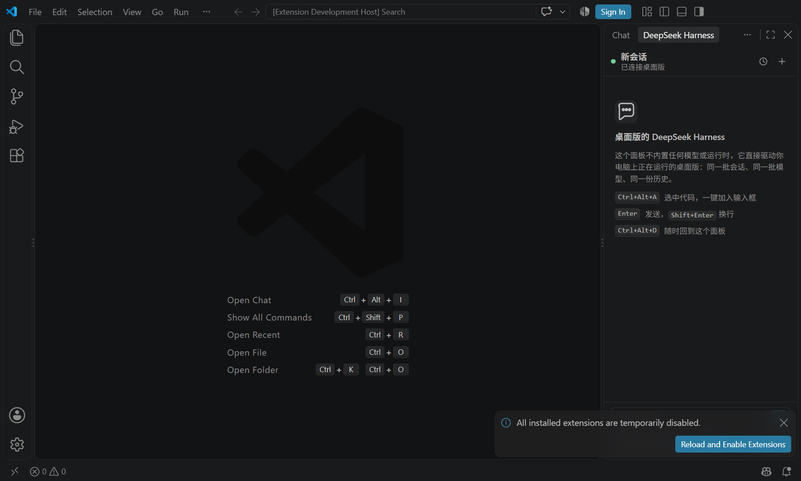

# DeepSeek Harness for VS Code

在 VS Code 侧边栏里直接使用你电脑上**正在运行的桌面版 DeepSeek Harness**：同一批会话、同一批模型、同一份历史，代码选区一键带进对话。

这个扩展不内置任何模型、运行时或 `dsh` 副本。它只是一个很薄的客户端：面板里的每一条消息都由桌面版真正生成，并且立刻出现在桌面版的会话里。

## 它长什么样

- **右侧栏面板**：会话列表、模型选择、流式输出、工具调用卡片都在一个视图里。
- **模型就是你加过的那些**：模型目录直接读自桌面版，`provider / model / 推理强度` 三级可选，带**置顶**与**最近使用**。
- **历史同步**：面板列出桌面版的全部会话（可按当前工作区过滤），点开即读同一份日志；你在桌面版里继续聊，面板里也会跟着更新。
- **会话操作**：右上角「⋯」可**重命名**当前会话、**创建分支**（fork 到新会话，不影响原会话）。
- **选中代码即入框**：`Ctrl+Alt+A`（macOS `Cmd+Alt+A`）把选区作为带路径和行号的代码块加入输入框。
- **图片也能发**：输入框里直接 `Ctrl+V` 粘贴截图，或把图片拖进来，随消息一起发给桌面版。
- **流式可见**：思考过程可折叠，正文逐字出现，每条回复带 token 用量（`↑输入 ↓输出`）。
- **工具卡片结构化**：`read` 显示带行号的文件片段，`edit` 显示红/绿 diff，`bash` 显示命令与输出。

## 使用前提

1. 桌面版 DeepSeek Harness 已安装并**正在运行**。
2. 桌面版里安装了配套的桥接插件 `dsh-vscode-panel-bridge`（本仓库 `bridge/` 目录，安装脚本会自动完成）。

## 安装

```powershell
# 在仓库根目录
powershell -ExecutionPolicy Bypass -File scripts\install.ps1
```

脚本会：

1. 把 `bridge/` 打包并安装进桌面版的 profile（`dsh plugin --profile desktop add ...`）；
2. 构建并安装本扩展（`code --install-extension`）。

完成后**重启桌面版 DeepSeek Harness**，再重载 VS Code 窗口（`Developer: Reload Window`）。

手动安装也可以：

```powershell
# 1) 桥接插件
cd bridge
npm pack
& "D:\dsh\resources\runtime\cli\bin\dsh.cmd" plugin --profile desktop add .\dsh-vscode-panel-bridge-0.1.4.tgz

# 2) 扩展
cd ..\extension
npm install
node esbuild.mjs
npx @vscode/vsce package --no-dependencies --allow-missing-repository
code --install-extension dsh-vscode-panel-0.1.0.vsix
```

## 位置：右侧栏

面板直接声明在**辅助侧边栏（右侧栏）**里：展开 VS Code 右侧栏，顶部图标条里就是 DeepSeek Harness 的图标，点开即是会话面板。右侧栏收起时，`Ctrl+Alt+D` 或命令「打开对话面板」会自动展开并聚焦。

想换位置时运行命令 **DeepSeek Harness: 移动面板位置…**，选目标位置即可。

> 需要 VS Code 1.10x 及以上（`viewsContainers.secondarySidebar`）。

## 快捷键

| 操作 | 方式 |
| --- | --- |
| 打开对话面板 | `Ctrl+Alt+D` |
| 选中代码加入对话 | `Ctrl+Alt+A`；或编辑器右键菜单；或选中文本后编辑器标题栏的「＋」按钮 |
| 发送 / 换行 | `Enter` / `Shift+Enter` |
| 停止生成 | 发送按钮（生成中变为停止） |
| 粘贴图片 | 输入框内 `Ctrl+V`，或拖拽图片到输入框 |
| 重命名 / 分支会话 | 面板右上角「⋯」 |
| 查看扩展日志 | 命令 `DeepSeek Harness: 显示日志` |

选中代码后，**右下角状态栏**会出现 `DSH 已引用 1 段`——这是快捷键生效的直接反馈；点它就能打开面板。面板没开时也会先记下引用，打开后直接出现在输入框上方。

## 发布 / 分发给别人

扩展是自包含的：桥接插件的 tgz 已经打进 VSIX，别人装完扩展后执行
**「DeepSeek Harness: 安装桥接插件到桌面版」** 即可写入桌面版 profile，不需要 clone 本仓库。

- 本地出包：`npm run vsix` → `extension/dsh-vscode-panel-1.0.0.vsix`
- 发给别人：对方在 VS Code「扩展 → ⋯ → 从 VSIX 安装」
- 发布到市场：见 [PUBLISHING.md](PUBLISHING.md)（需要 publisher + Azure DevOps PAT）

## 设置

| 设置 | 说明 |
| --- | --- |
| `dsh.bridgeFile` | 桥接描述文件路径，默认 `%USERPROFILE%\.dsh\vscode-panel\bridge.json` |
| `dsh.home` | `DSH_HOME`，默认环境变量或 `%USERPROFILE%\.dsh` |
| `dsh.desktopPath` | 桌面版可执行文件路径，用于「启动桌面版」按钮 |
| `dsh.maxContextLines` | 单次加入对话的最大行数（默认 400） |
| `dsh.contextFormat` | 代码引用格式：`fenced` 代码块或 `plain` 缩进 |

修改 `dsh.home` / `dsh.bridgeFile` 会**立即重连**，不需要重载窗口。

## 故障排查

**面板显示「未连接」**
1. 确认桌面版正在运行；
2. 看 `%USERPROFILE%\.dsh\vscode-panel\bridge.json` 是否存在（桥接插件只在桌面版启动时写入）；
3. 若刚安装完桥接插件，重启桌面版；
4. 运行命令 `DeepSeek Harness: 刷新连接与会话`。

**模型列表是空的**
桌面版没有可路由的模型（例如没有配置 API Key）。先在桌面版里把模型配好。

**按 Ctrl+Alt+A 没有任何反应**
1. 看右下角状态栏有没有出现 `DSH 已引用 N 段`；
2. 没有出现说明快捷键没被触发：多半是输入法或其它软件占用了 `Ctrl+Alt+A`。用编辑器右键菜单或标题栏的「＋」按钮，或在快捷键设置里给 `dsh.addSelectionToChat` 换一个组合键；
3. 出现了但面板里没有：执行命令 `DeepSeek Harness: 显示日志`，日志里会写明「context +文件:行号」。

**发送后桌面版里看不到**
面板和桌面版共用同一个 `DSH_HOME` 会话库。如果桌面版用不同的 `DSH_HOME` 启动，两边就是两套数据；把 `dsh.home` 设成桌面版实际使用的目录即可。

## 工作原理

```
VS Code 扩展  ──HTTP + SSE（127.0.0.1，随机端口 + 一次性令牌）──▶  桥接插件（运行在桌面版进程内）
                                                                   │
                                                                   ▼
                                                          ctx.sessionController
                                                          （桌面 UI 用的同一个服务）
```

桥接插件不复制任何 DSH 逻辑：会话列表、历史分页、提示词准入、模型目录、流式事件全部来自桌面版自己的 Session Controller。因此面板里发生的每一件事，桌面版都看得见，反之亦然。

令牌与端口写在 `%USERPROFILE%\.dsh\vscode-panel\bridge.json`（仅当前用户可读），监听地址固定 `127.0.0.1`。

## 仓库结构

```
bridge/     DSH 宿主插件（零依赖 ESM，装进桌面版 profile）
extension/  VS Code 扩展（TypeScript + esbuild，webview 无框架）
scripts/    安装、冒烟测试、预览与截图脚本
test/       用 VS Code API 桩跑扩展宿主逻辑的无头端到端测试
preview/    webview 视觉预览（浏览器打开即可看 UI）
```

## 开发

```powershell
# 1) 扩展热构建
cd extension
npm install
node esbuild.mjs --watch

# 2) 隔离的测试 host（复制桌面版的模型配置，不碰正在运行的桌面版）
powershell -ExecutionPolicy Bypass -File ..\scripts\dev-host.ps1

# 3) 端到端
npm run test:bridge                     # 协议冒烟：会话/模型/流式
npm run test:harness                    # 用 VS Code API 桩跑扩展宿主逻辑
npm run test:vscode                     # 真 VS Code 扩展宿主里跑一遍
npm run preview:build; npm run preview  # 浏览器里看 webview UI

# 4) 视觉确认（截图 + DOM 检查）
node test\vscode-suite\visual-run.mjs    # 起一个真实的 VS Code 窗口并停住
node scripts\inspect-vscode.mjs          # 通过 CDP 截图并打印侧边栏结构
```

`test:vscode` 会用 `@vscode/test-electron` 启动已安装的 VS Code（可用 `VSCODE_EXE` 指定），
并读取 `DSH_HOME` 指向的桥接文件；默认使用当前用户的 `%USERPROFILE%\.dsh`。

面板在真实 VS Code 里的样子（CDP 截图，右侧栏）：



## License

MIT
